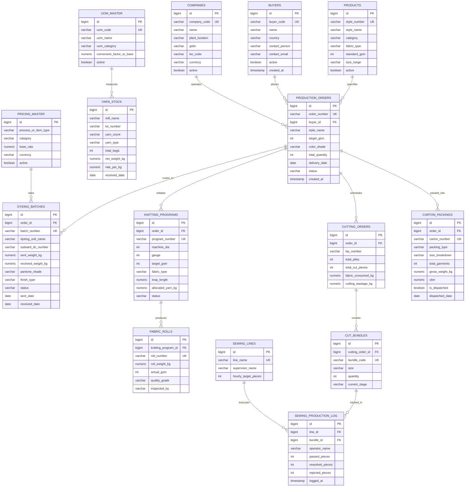
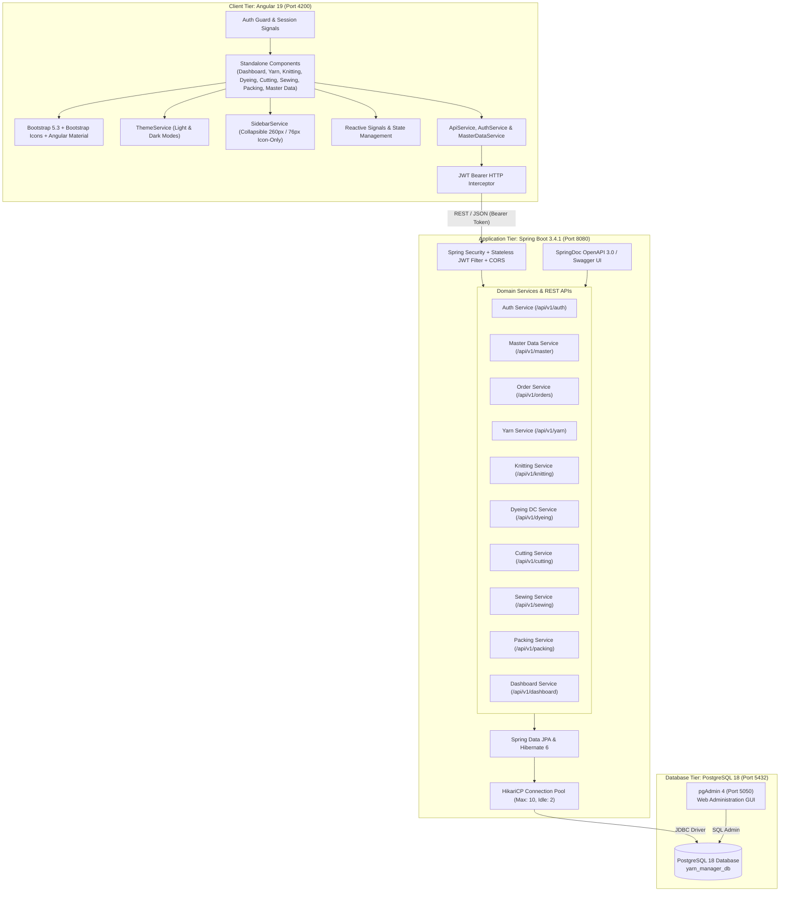
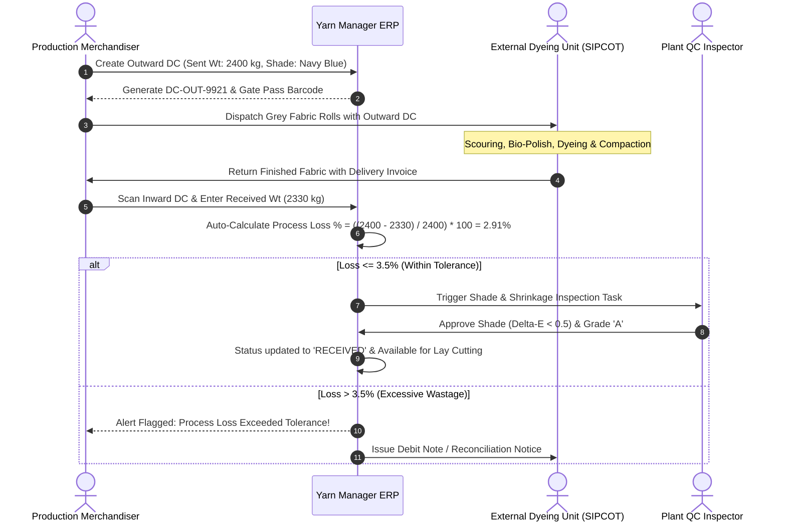

# Yarn Manager (TexFlow Tiruppur ERP & MES)

> **Enterprise Manufacturing Execution System & ERP for the Tiruppur Knitwear & Garment Export Cluster**  
> Complete industrial lifecycle tracking converting raw spun yarn cones into finished packaged clothes, equipped with dynamic Master Data setup, JWT role-based security, collapsible responsive UI, and light/dark theme design system.

---

## 🏭 System Architecture & Process Diagrams

### 1. Detailed Industrial Manufacturing Flow (Yarn-to-Garment)

```mermaid
flowchart TD
    subgraph S1["Stage 1: Yarn Procurement & Inward"]
        Y1["Spinning Mill Inward<br/>(KPR, Ramco, Bannari)"] --> Y2["Yarn QC & Lot Registration<br/>(Counts: 30s, 34s, Lycra, Melange)"]
        Y2 --> Y3[("Yarn Warehouse Stock<br/>Bags & Net Weight kg")]
    end

    subgraph S2["Stage 2: Circular Knitting"]
        Y3 --> K1["Knitting Program Allocation<br/>(Dia 30 inch, 24 GG, Loop 2.85mm)"]
        K1 --> K2["Circular Knitting Machines<br/>(Single Jersey / Rib / Fleece)"]
        K2 --> K3["Grey Fabric Rolls Weighed & Barcoded<br/>(Actual GSM & Grade A/B)"]
        K3 --> K4{"Knitting Loss Check<br/>(Tolerance <= 2%)"}
    end

    subgraph S3["Stage 3: Dyeing & Wet Processing (Job Work)"]
        K4 --> D1["Outward Delivery Challan DC<br/>Sent to SIPCOT / Perundurai"]
        D1 --> D2["Dyeing & Compaction<br/>(Bio-Wash Silicon Finish)"]
        D2 --> D3["Inward DC Receipt & Reconcile<br/>(Net Weight & Shade Approval)"]
        D3 --> D4{"Process Loss Check<br/>(Tolerance <= 3.5%)"}
    end

    subgraph S4["Stage 4: Lay Planning & Cutting Section"]
        D4 --> C1["Fabric Relaxation & Spreading<br/>(Plies Count & Lay Length)"]
        C1 --> C2["Panel Cutting<br/>(Front, Back, Sleeve, Rib)"]
        C2 --> C3["QR Bundle Ticketing<br/>(Size: S, M, L, XL, XXL)"]
    end

    subgraph S5["Stage 5: Value Addition (Optional Job Work)"]
        C3 --> V1["Screen Printing / Embroidery<br/>(Outward & Inward DC)"]
    end

    subgraph S6["Stage 6: Sewing Assembly Lines"]
        V1 --> W1["Line Loading & Bundle Scan<br/>(Line 1 Overlock / Line 2 Flatlock)"]
        W1 --> W2["Assembly Operations<br/>(Collar attach, Sleeve, Hem)"]
        W2 --> W3["Inline & End-line QA<br/>(Passed, Rework, Rejected)"]
        W3 --> W4{"DHU Defect Rate<br/>(Target < 2.5%)"}
    end

    subgraph S7["Stage 7: Finishing, Packing & Dispatch"]
        W4 --> P1["Thread Trimming & Steam Ironing"]
        P1 --> P2["Carton Packing Matrix<br/>(Solid / Assorted Ratio)"]
        P2 --> P3["Carton CBM & Gross Wt<br/>(Export Barcode Labeled)"]
        P3 --> P4["Shipment & Dispatch Invoice<br/>(Buyer PO Completed)"]
    end
```



---

### 2. Configurable Dynamic Workflow Architecture

Rather than hardcoding customer pipeline stages, TexFlow supports configurable workflow state machines:

```mermaid
flowchart LR
    MD["Mermaid / JSON<br/>Workflow Blueprint"] --> PARSER["Workflow Definition Engine"]
    PARSER --> REGISTRY["Pipeline Stage Registry"]
    REGISTRY --> TRANS["Transition Validator & Rules"]
    TRANS --> EXEC["Stage Execution & Dispatch"]

    subgraph WORKFLOW_STAGES["Dynamic Pipeline Stage Transitions"]
        direction LR
        ST_YARN["1. Yarn Inward"] --> ST_KNIT["2. Knitting"]
        ST_KNIT --> ST_DYE["3. Dyeing DC"]
        ST_DYE --> ST_CUT["4. Lay Cutting"]
        ST_CUT -.->|"Optional"| ST_PRINT["Job Work Print"]
        ST_PRINT -.-> ST_SEW["5. Sewing Line"]
        ST_CUT --> ST_SEW
        ST_SEW --> ST_PACK["6. Carton Dispatch"]
    end
    EXEC --> WORKFLOW_STAGES
```



---

### 3. Relational Database Schema (PostgreSQL 18 ERD)



---

### 4. Full-Stack System Architecture



---

### 5. Dyeing Job Work Delivery Challan (DC) Reconciliation Flow



---

## 🌟 Key Features & Capabilities

### 1. Master Data Hub (`/master`)
Centralized management for factory foundation entities, replacing hardcoded constants with dynamic database records:
- **Units of Measure (UOM)**: Standard textile measurement units (`KG`, `BAGS`, `METERS`, `ROLLS`, `PCS`, `DOZENS`, `CARTONS`) with base conversion multipliers.
- **Process Pricing & Rate Cards**: Industrial rate cards per kg/piece for Knitting, Dyeing, Compacting, Lay Cutting, Sewing, and Bio-Wash finishes.
- **Customer / Buyer Directory**: International and domestic apparel brands, export destination country, contact details, payment currencies, and active status.
- **Company Master**: Multi-entity plant profiling (Tiruppur Unit #1, Netaji Apparel Park Unit, etc.), GSTIN, IEC export code, and headquarters details.
- **Product / Garment Styles**: Master product catalog with style codes, fabric specifications (Single Jersey, Rib, Interlock), target GSM, and size curves.

### 2. Collapsible UI Sidebar (Icon-Only Mode)
- **Compact View (76px)**: Collapses text labels to icon-only navigation with hover tooltips (`[title]`) for clean, distraction-free floor terminals.
- **Expanded View (260px)**: Full brand headers, stage sequence numbers, and database status indicators.
- **Dual Toggle Controls**: Quick toggle button in the sidebar header and top navbar.
- **Persistent State**: Automatically stored in `localStorage` via Angular signals.

### 3. Light & Dark Mode Theming
- Built on Bootstrap 5.3 color modes (`[data-bs-theme="dark"]` / `[data-bs-theme="light"]`) with custom CSS custom properties (`--app-bg`, `--app-card-bg`, `--app-sidebar-bg`, `--app-text`).
- Instant theme toggle in the top navbar with persistent user preference in `localStorage`.

### 4. JWT Authentication & Role-Based Access Control (RBAC)
- Stateless authentication with signed HMAC-SHA256 JWT bearer tokens.
- Secure HTTP interceptor (`auth.interceptor.ts`) attaching bearer tokens to API calls.
- Plant roles:
  - `ROLE_ADMIN`: Full system administration and master data configuration.
  - `ROLE_SUPERVISOR`: Floor line execution, knitting programs, and cutting schedules.
  - `ROLE_QC_LEAD`: Roll quality inspection, dyeing shade clearance, and DHU logs.
  - `ROLE_OPERATOR`: Daily bundle tracking and scan inputs.

### 5. Full Manufacturing Lifecycle (Stage 1 to Stage 6)
- **Yarn Inward**: Warehouse inventory tracking by Mill, Lot, Yarn Count, Net Weight, and Bags.
- **Circular Knitting**: Machine dia, gauge, target GSM, loop length, roll barcoding, and knitting loss % verification.
- **Dyeing DC Tracking**: Subcontract job-work challan management with automated process loss % and debit alert calculation.
- **Cutting & Bundles**: Lay planning, plies calculation, wastage tracking, and bundle QR ticketing.
- **Sewing Assembly**: Hourly line balancing and real-time Defects per Hundred Units (DHU %) tracking.
- **Carton Packing & Dispatch**: Assorted/solid packing matrix, volumetric CBM, gross weight, and dispatch labeling.

---

## 🏗️ Technology Stack

| Layer | Technology | Key Libraries / Modules |
|---|---|---|
| **Backend** | Java 21 / 22 (Corretto), Spring Boot 3.4.1 | Spring Data JPA, Spring Security 6, JJWT (`0.12.6`), Hibernate 6, HikariCP, Lombok |
| **Frontend** | Angular 19 (Standalone Components) | Angular Signals, Bootstrap 5.3.3, Bootstrap Icons 1.11.3, Angular Material 19, RxJS 7.8 |
| **Database** | PostgreSQL 18 | Normalized relational schema, indexes, cascade foreign keys, automated DDL defaults |
| **API Docs** | SpringDoc OpenAPI 3.0 | Swagger UI interactive explorer (`/swagger-ui.html`) |
| **DevOps** | Docker & Docker Compose | Containerized PostgreSQL 18 & pgAdmin 4 |

---

## 📁 Project Structure

```text
yarn-manager/
├── docker-compose.yml             # Orchestration for PostgreSQL 18 and pgAdmin
├── README.md                      # Project documentation and architectural diagrams
├── database/
│   ├── 01-schema.sql              # Normalized DDL schema with relational tables & indexes
│   └── 02-seed-data.sql           # Realistic Tiruppur mill & garment production seed data
├── backend/                       # Spring Boot 3.4.1 Application
│   ├── pom.xml
│   ├── mvnw & mvnw.cmd            # Zero-install Maven Wrapper
│   ├── src/main/resources/
│   │   └── application.yml        # PostgreSQL, HikariCP, and JWT settings
│   └── src/main/java/com/tiruppur/yarnmanager/
│       ├── YarnManagerApplication.java
│       ├── config/                # OpenAPI Swagger configuration
│       ├── common/                # Standard API response wrappers & exception advice
│       ├── security/              # Spring Security, JWT utilities, and Auth Filter
│       │   ├── WebSecurityConfig.java
│       │   ├── UserDetailsServiceImpl.java
│       │   └── jwt/               # JwtUtils, AuthTokenFilter, AuthEntryPointJwt
│       └── domain/
│           ├── auth/              # Login, register, and token refresh endpoints
│           ├── master/            # Master Data Hub (UOM, Pricing, Buyers, Companies, Products)
│           │   ├── entity/        # UomMaster, PricingMaster, CompanyMaster, ProductMaster
│           │   ├── repository/    # Spring Data JPA repositories
│           │   ├── service/       # MasterDataService
│           │   └── controller/    # MasterDataController (/api/v1/master)
│           ├── order/             # Buyer styles and PO management
│           ├── yarn/              # Yarn stock and inward receipt
│           ├── knitting/          # Circular knitting programs & roll barcodes
│           ├── dyeing/            # Job work Delivery Challan & reconciliation
│           ├── cutting/           # Lay cutting and QR bundle ticketing
│           ├── sewing/            # Assembly lines, hourly logs & QA
│           ├── packing/           # Carton packaging & CBM calculator
│           └── dashboard/         # Real-time pipeline KPI metrics
└── frontend/                      # Angular 19 Client Application
    ├── package.json
    ├── angular.json
    └── src/
        ├── index.html
        ├── styles.css             # Bootstrap 5, Bootstrap Icons & theme design system
        └── app/
            ├── app.component.ts   # Root layout with reactive theme and auth state
            ├── app.routes.ts      # Lazy-loaded routes with auth guards
            ├── core/
            │   ├── guards/        # auth.guard.ts
            │   ├── interceptors/  # auth.interceptor.ts (Bearer token injector)
            │   ├── models/        # TypeScript interfaces & models
            │   └── services/      # ApiService, AuthService, ThemeService, SidebarService, MasterDataService
            ├── utilities/         # Industrial formulas (knitting loss, dyeing loss, DHU, CBM)
            ├── shared/
            │   ├── navbar/        # Shift status, theme switcher, sidebar toggle, user profile
            │   └── sidebar/       # Collapsible navigation with icon-only mode and tooltips
            └── features/          # Feature components (.ts, .html, .spec.ts)
                ├── auth/login/    # JWT factory floor personnel login
                ├── dashboard/     # Conversion pipeline KPI cards
                ├── master/        # Master Data Hub (UOM, Rate Cards, Buyers, Companies, Products)
                ├── yarn/          # Warehouse stock & inward receipt
                ├── knitting/      # Circular knitting & roll inspector
                ├── dyeing/        # DC outward/inward reconciliation
                ├── cutting/       # Lay cutting & QR bundle tickets
                ├── sewing/        # Line balancing & DHU inspection
                └── packing/       # Carton packaging & CBM calculator
```

---

## 🚀 Quick Start Guide

### 1. Database Setup (PostgreSQL)

Launch PostgreSQL 18 and pgAdmin using Docker Compose:

```bash
docker compose up -d postgres pgadmin
```

* **PostgreSQL Port**: `5432` (`yarn_manager_db` / `postgres` / `postgrespassword`)
* **pgAdmin 4 GUI**: [http://localhost:5050](http://localhost:5050) (`admin@tiruppurtextiles.com` / `adminpassword`)

Alternatively, run locally on native PostgreSQL 18:
```powershell
& "C:\Program Files\PostgreSQL\18\bin\psql.exe" -U postgres -c "CREATE DATABASE yarn_manager_db;"
& "C:\Program Files\PostgreSQL\18\bin\psql.exe" -U postgres -d yarn_manager_db -f .\database\01-schema.sql
& "C:\Program Files\PostgreSQL\18\bin\psql.exe" -U postgres -d yarn_manager_db -f .\database\02-seed-data.sql
```

---

### 2. Backend Setup (Spring Boot)

Run unit tests and start the backend service:

```powershell
cd D:\Projects\Github\yarn-manager\backend

# Run all 14 JUnit 5 tests
.\mvnw.cmd test

# Run application
.\mvnw.cmd spring-boot:run
```

* **API Base URL**: `http://localhost:8080/api/v1`
* **Swagger UI Documentation**: [http://localhost:8080/swagger-ui.html](http://localhost:8080/swagger-ui.html)
* **OpenAPI 3.0 Schema**: `http://localhost:8080/v3/api-docs`

---

### 3. Frontend Setup (Angular 19)

Install packages, run unit tests, and start the development server:

```powershell
cd D:\Projects\Github\yarn-manager\frontend

# Install dependencies
npm install

# Run all 48 Angular unit tests in headless Chrome
npm test -- --watch=false --browsers=ChromeHeadless

# Start Angular development server
npm start
```

Open [http://localhost:4200](http://localhost:4200) in your browser.

#### Demo Credentials:
| Username | Password | Role | Access Level |
|---|---|---|---|
| `admin` | `admin123` | `ROLE_ADMIN` | Full access to all stages and Master Data Hub |
| `supervisor` | `super123` | `ROLE_SUPERVISOR` | Floor operations, knitting programs, and sewing lines |
| `qc_lead` | `qc123` | `ROLE_QC_LEAD` | Roll inspections, dyeing DC approvals, and defect logs |

---

## 🧪 Testing & Verification Summary

- **Backend**: 14/14 automated JUnit 5 tests passing across Authentication, JWT, and Master Data domain services.
- **Frontend**: 48/48 Jasmine & Karma unit tests passing across all components, guards, interceptors, and services.
- **Production Build**: Successfully validated via `npm run build` with zero compiler errors.
